# Credit scoring: an end-to-end example

Credit scoring in MicroPay Banking gives a loan a score, a grade, and an outcome: Approve, Refer, or Decline. It can also give an agent a pre-approved limit. This guide follows one example from a blank scorecard through to a disbursed loan. The points and cut-offs are examples. Your credit team sets the numbers for your own portfolio.

## Before you start

| Who | What they can do | Steps in this guide |
| --- | --- | --- |
| Credit manager | Create and activate scorecards, turn scoring on for a product, set authority rules and limit policies, run the behavioural job | Parts 1, 2, 3, 5, and 7 |
| Loan officer | Submit a loan, read the credit score, request an override when they are allowed | Parts 4, 6, and 7 |
| Approver | Open the checker inbox and approve held changes, including loan approval | Parts 5 and 6 |

In this example one officer does the credit-manager and loan-officer steps to keep the walkthrough short. In production these are separate users, and the checker is always a different person from the maker.

Some saves do not apply immediately. You will see **Submitted for approval**. The change appears after the checker approves it. This guide shows that on the scorecard, the product, the authority rules, the override, and the loan approval.

## The example

Amina Nakato is an agent. Her float savings show steady deposits, and she has been a customer for 30 months. She has no stored late-payment history.

Brian Okello is a new customer. He is not an agent. He has no float deposits, and he has been a customer for about two months.

| Product | What it is for |
| --- | --- |
| Agent instant loan | Scored when the application is submitted. Scorecard DEMO_AGENT. |
| Agent float loan | Drawn against a pre-approved limit. Policy DEMO_AGENT_FLOAT. |

All amounts are in UGX. The business date in this example is 16 Oct 2026. A score is stamped with the clock time when it was calculated, which can be later than that business date.

## Part 1 — Build a scorecard

By the end of this part, DEMO_AGENT exists as a draft you can still change.

### Scorecards list

Scorecards live in one list, with a draft and a live version of each code.

Open **System**, then **Credit scoring**. Stay on the **Scorecards** tab.

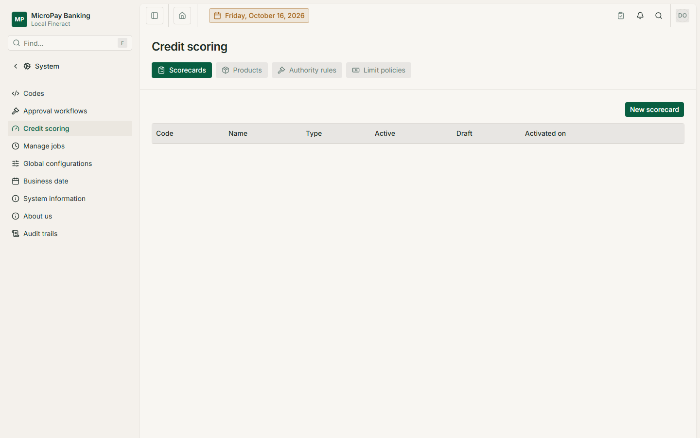

You see **New scorecard**. Existing cards, if any, show an active version, a draft, or both.

### Scorecard header

The header names the card and sets the points every applicant starts with.

Click **New scorecard**. Set **Code** to DEMO_AGENT, **Name** to Agent instant loan, **Type** to Application, and **Base points** to 300.

> **Tip:** The code cannot change after you save. Use a short name your products can share, such as DEMO_AGENT.

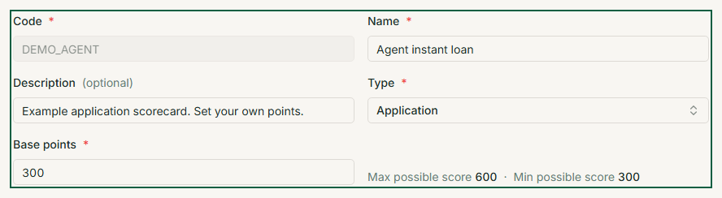

Max possible score is 600 once the bins below are in place. These points are an example. Your credit team sets its own.

### Scorecard bins

Bins turn a customer fact into points.

Click **Next**, then **Add bin** for each row: savings deposits under 500,000 score 0 (LOW_DEPOSITS), from 500,000 score 60 (MODERATE_DEPOSITS), and from 2,000,000 score 120. Months active under 6 score 0 (SHORT_TENURE), from 6 score 40 (MEDIUM_TENURE), and from 24 score 80. Days late when missing score 30 (NO_HISTORY), under 1 score 100, from 1 score 50 (PAST_LATE_PAYMENT), and from 30 score 0 (SERIOUS_PAST_ARREARS).

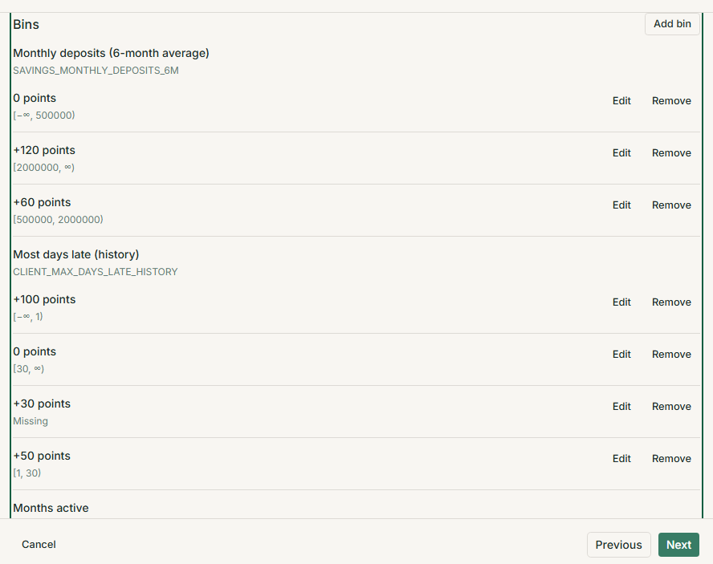

The reason on the best bin in each group is greyed out, because a customer there loses no points.

### Grade bands

A grade band turns the total into Approve, Refer, or Decline.

Click **Next**, then **Add band**. A is 560 to 1,000, PD 1%, Approve. B is 480 to 559, PD 3%, Approve. C is 420 to 479, PD 7%, Refer. D is 360 to 419, PD 15%, Refer. E is 0 to 359, PD 30%, Decline.

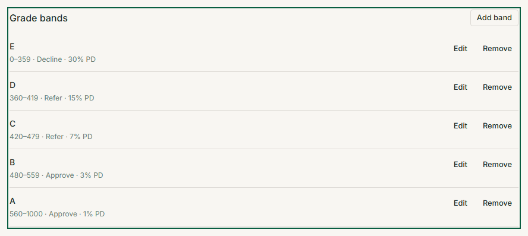

The bands meet without a gap or an overlap warning. PD is the expected chance of default for that grade.

### Scorecard rules

A rule can force an outcome before the grade is used.

Click **Next**, then **Add rule**. Add Expired ID, Blacklisted, and Customer class not eligible, each Decline. Add a Characteristic rule: CLIENT_IS_STAFF, Not equal, true, Decline, reason NOT_AN_AGENT. Add CLIENT_CURRENT_DAYS_IN_ARREARS, Greater than, 30, Decline, reason IN_ARREARS.

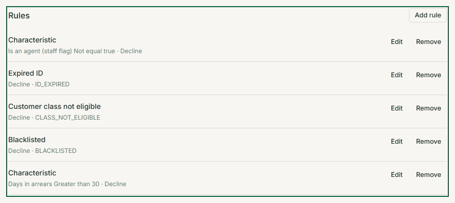

NOT_AN_AGENT is the rule that declines a customer who is not an agent, even when the points would pass.

### Draft saved

A draft is not used on live loans until you activate it.

Click **Save draft**.

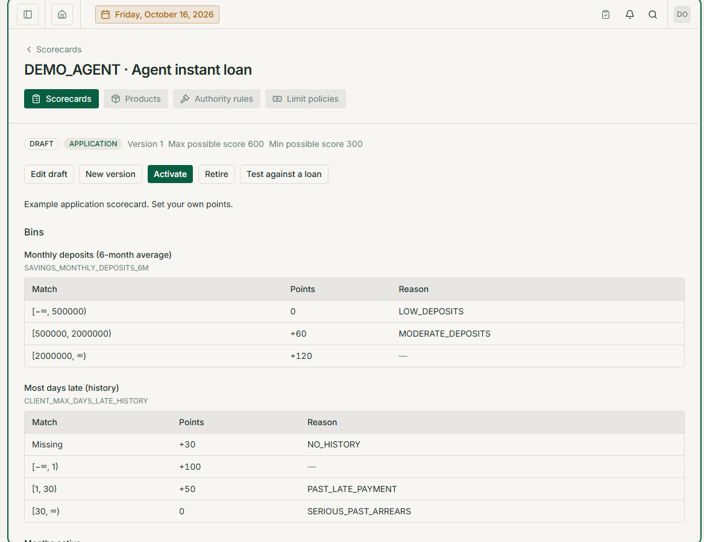

The card opens with status DRAFT. You can still click **Edit draft**.

Under the hood

Creating the draft calls the scorecards endpoint. Bins, grade bands, and rules are saved with the card.

## Part 2 — Test it on a real loan

By the end of this part, you have scored Amina Nakato’s existing loan without storing the decision.

### Test the scorecard

You can score a real loan against this version without saving the decision.

Click **Test against a loan**. Enter Amina’s loan account number and click **Run test**.

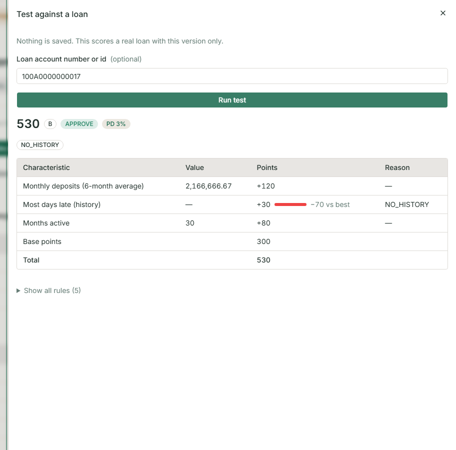

The score is 530, grade B, outcome APPROVE, PD 3%. The only reason is NO_HISTORY. History shows +30 and −70 vs best. The sheet says nothing is saved.

Under the hood

Test against a loan calls the scorecard test command with that loan id. It does not write a decision on the loan.

## Part 3 — Turn scoring on for a product

By the end of this part, DEMO_AGENT is live on the Agent instant loan, in Advisory mode.

### Activate the draft

Activation is the moment this version becomes the one new loans use.

Click **Activate**.

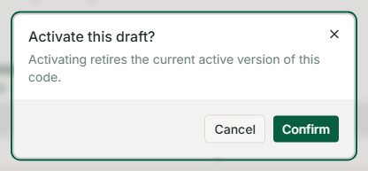

The dialog says activating retires the current active version of this code. Click **Confirm**. If your office uses a checker, the card stays draft until that person approves.

### Active scorecard

Only the active version is offered on a loan product.

Return to the scorecard after the checker has approved it.

> **Important:** An active scorecard cannot be edited. Click **New version** to copy it into a new draft.

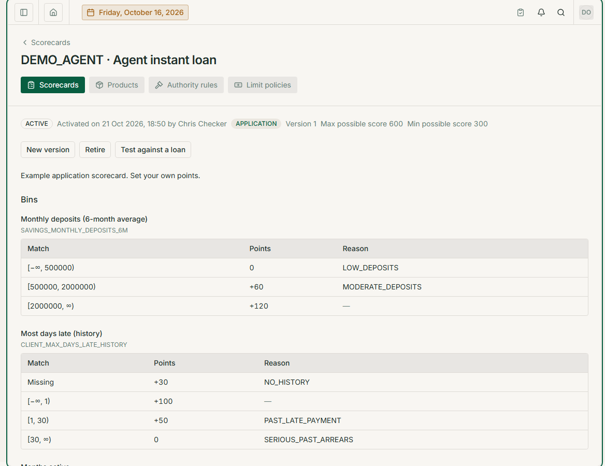

Status is ACTIVE, and the page shows who activated it and when. **Edit draft** is gone.

### Advisory mode

A product does not use a scorecard until you attach one and choose a mode.

Open the **Products** tab. On Agent instant loan, click **Edit**. Choose scorecard DEMO_AGENT and mode **Advisory**, then **Save**.

> **Tip:** Start in Advisory for a few weeks before you switch to Enforced. You can read real scores before they block a loan.

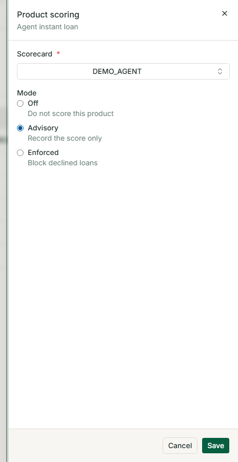

Advisory means the score is stored and shown, and a decline does not stop approval. The row shows DEMO_AGENT and ADVISORY.

Under the hood

Activate calls the scorecard activate command. Product mode is saved on the product scoring endpoint. Both can wait for a checker.

## Part 4 — Score a loan application

By the end of this part, Amina’s new 3,000,000 UGX application shows APPROVE, grade B, score 530.

### Amina’s application

The score is calculated when the application is submitted.

Open **Customers**, Amina Nakato, then **Loan accounts**, and click **New loan account**. Choose **Agent instant loan**, set the principal to 3,000,000 UGX, and click through to **Submit application**.

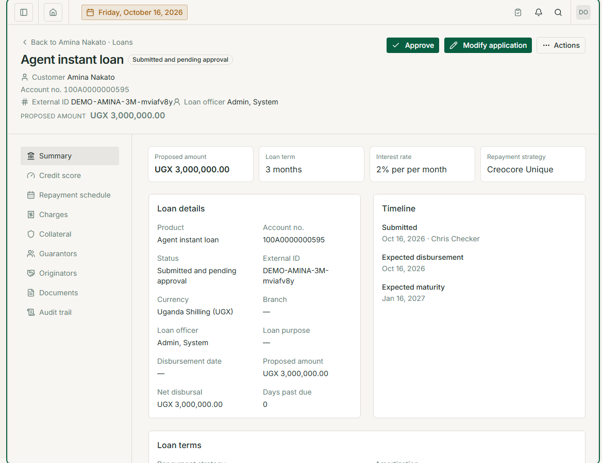

The loan is submitted and pending approval. The principal is UGX 3,000,000.00.

### Amina’s credit score

The loan officer reads the decision on the loan, not in the scorecard setup.

On the loan, click **Credit score**.

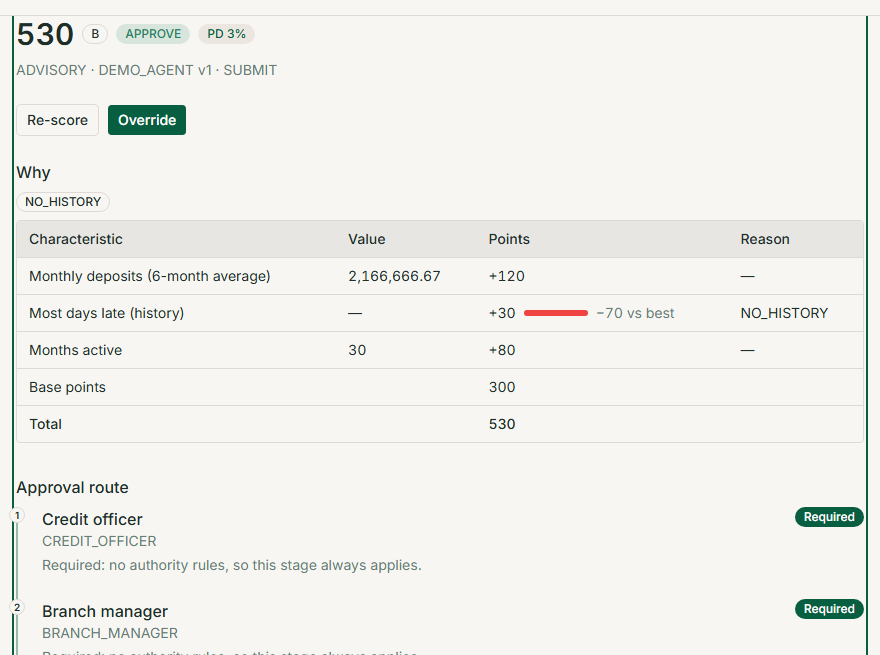

You see 530, grade B, APPROVE, and PD 3%. The line under the score says ADVISORY. Reason NO_HISTORY is shown. Deposits and tenure are at their best, so those reasons are absent.

### Decision inputs

The inputs show the facts the score used, so an officer can explain the number.

Under **History**, click the decision row.

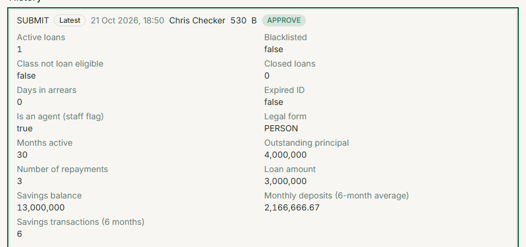

SAVINGS_MONTHLY_DEPOSITS_6M is about 2,166,667. CLIENT_MONTHS_ACTIVE is 30. CLIENT_MAX_DAYS_LATE_HISTORY is blank, which is the missing value that earned NO_HISTORY.

Under the hood

Submitting the loan stores an application decision. The Credit score tab reads that decision and its inputs.

## Part 5 — Route approvals by risk

By the end of this part, you have compared the route for 3,000,000 UGX with the route for 7,000,000 UGX, and the 3,000,000 UGX loan is approved.

### Authority rules

Authority rules decide which approval stages a loan must pass.

Open **Authority rules**. Leave **Task** on APPROVE_LOAN. Click **New rule** five times: Head of credit with minimum amount 5000000.01 (Demo: above 5m); Head of credit with outcome REFER (Demo: any referral); Credit committee with minimum amount 50000000.01 (Demo: above 50m); Credit committee with grades D and E (Demo: poor grades); Credit committee with **Overridden** set to Yes (Demo: overridden).

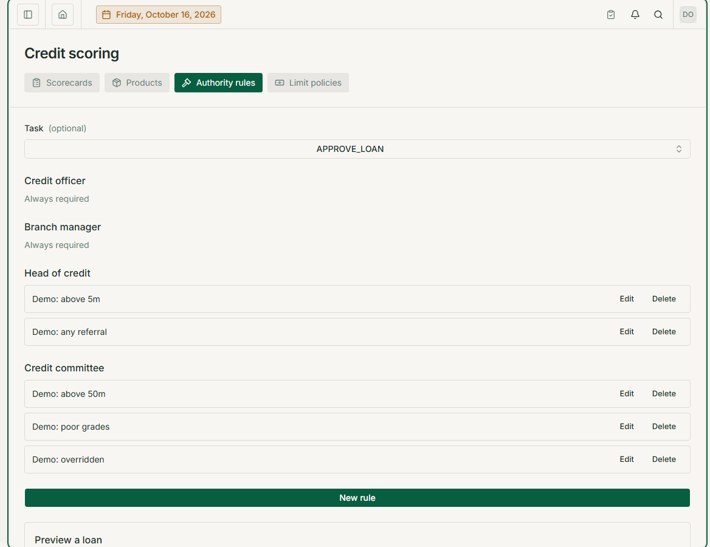

Head of credit lists the two Demo rules. Credit committee lists the other three. Credit officer and Branch manager stay always required until a rule names them.

### Route for 3,000,000

A small approved loan should not climb the whole ladder.

In **Preview a loan**, enter the id of Amina’s 3,000,000 UGX loan and click **Preview**.

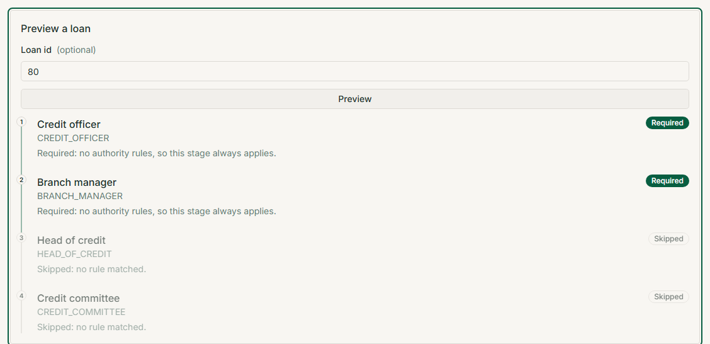

Credit officer and Branch manager are Required, because no rule names them. Head of credit and Credit committee are Skipped, because no rule matched.

### Route for 7,000,000

The same customer and grade take a longer route when the amount crosses 5,000,000 UGX.

Submit a second Agent instant loan for Amina for 7,000,000 UGX. Preview that loan id.

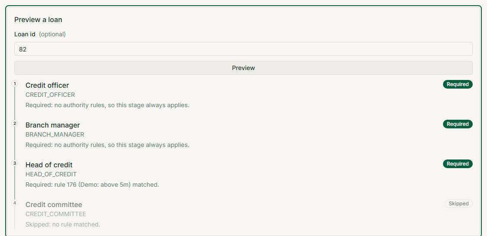

Head of credit is Required because the above-5m rule matched. Credit committee stays Skipped: 7,000,000 is below 50,000,000, the grade is not D or E, and the decision is not overridden.

### Approval held

Approving a loan can wait for a second person.

On the 3,000,000 UGX loan, click **Approve**, check the dates and amount, and click **Approve** again.

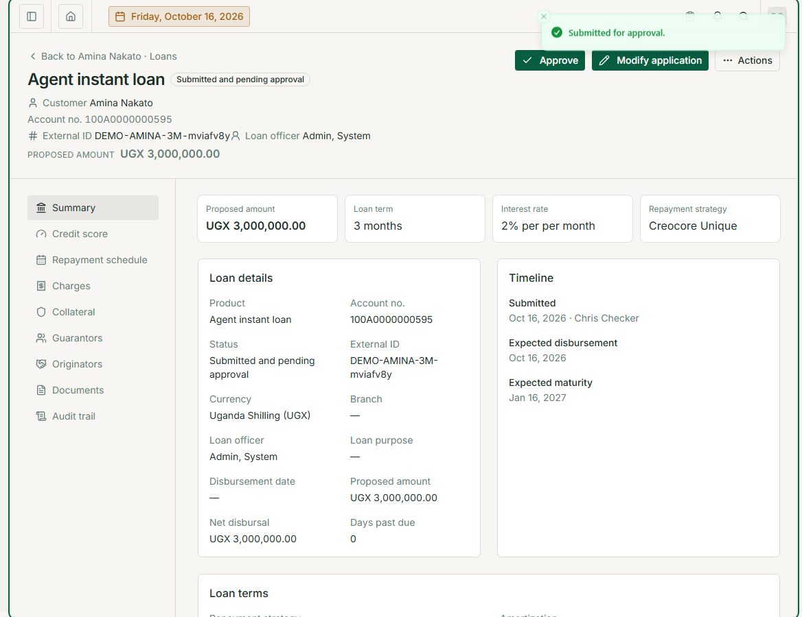

You see Submitted for approval. The loan stays Submitted and pending approval until the checker finishes it.

### Checker inbox

The checker works from the inbox, not from the loan officer’s screen.

Sign in as the checker. Open **Checker inbox**.

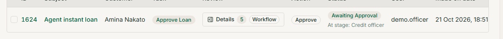

Amina Nakato’s pending approval is in the list, with the action and the stage it is on.

### Checker review

The checker should see the same score and route the officer saw.

Open the task.

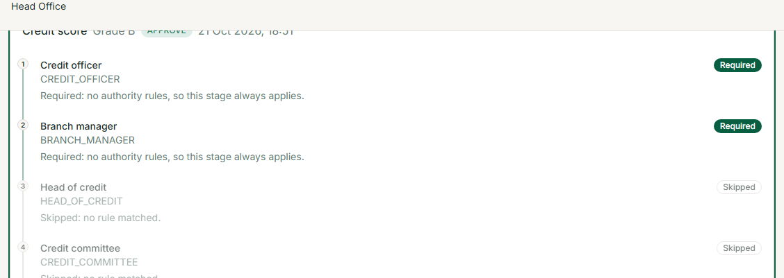

The credit score shows grade B and APPROVE. The route matches the preview: Credit officer and Branch manager required, later stages skipped.

### Amina approved

A fresh score is stored when the loan is approved.

Click **Approve** and confirm. Open the loan again and click **Credit score**.

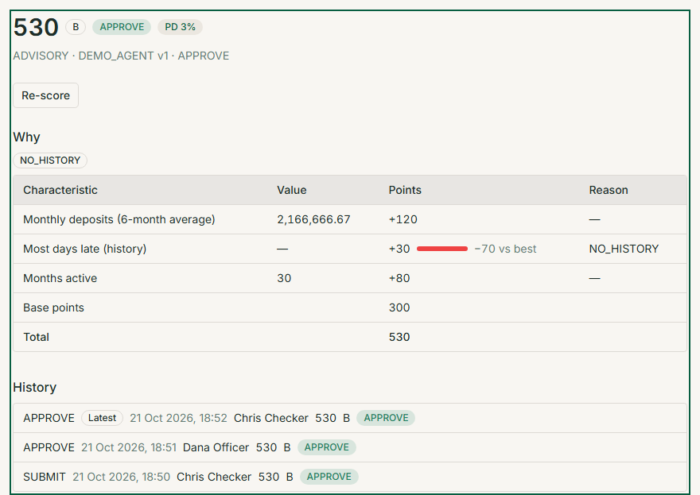

The loan status is Approved. History has the original submission and a new decision from the approval.

Under the hood

Authority rules and the approval-route preview are scoring endpoints. Approve loan is a loan command. When maker-checker is on, the checker approves it from the checker inbox.

## Part 6 — A declined loan and an override

By the end of this part, Brian Okello’s decline has been overridden to Refer, approved, and you have seen a re-score lapse that override.

### Enforced mode

Enforced mode is what makes a decline stop the loan.

As the credit manager, open **Products**, edit Agent instant loan, set **Mode** to **Enforced**, and save.

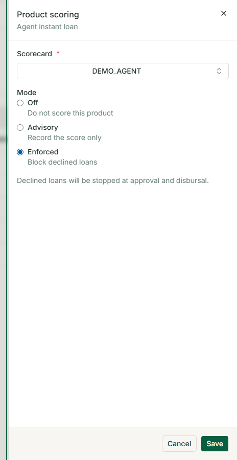

The sheet says declined loans will be stopped at approval and disbursal. The row shows ENFORCED.

### Brian’s decline

Brian is not an agent, so the card refuses the loan even though you can still read the points.

Open Brian Okello, create an Agent instant loan for 1,000,000 UGX, submit it, and open **Credit score**.

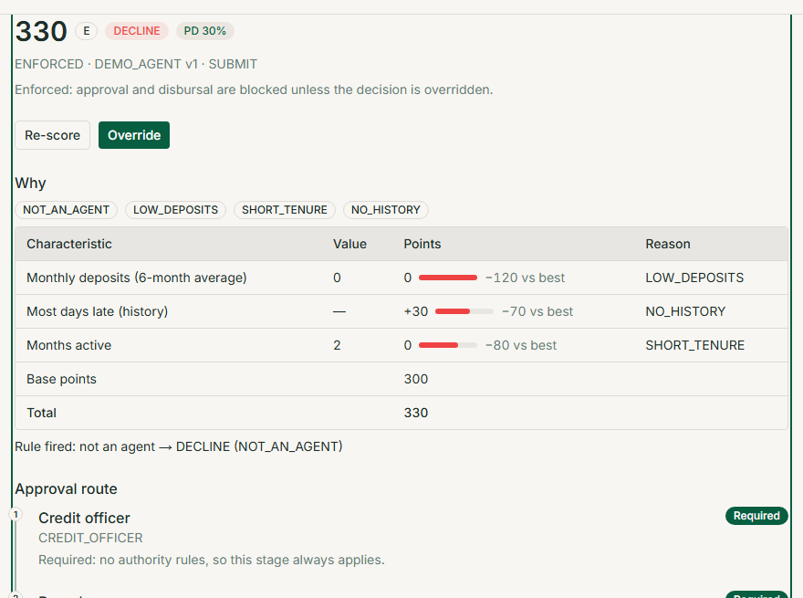

The score is 330 and the grade is E. The outcome is DECLINE, not “by rule”, because grade E is already a decline. Reasons are NOT_AN_AGENT, LOW_DEPOSITS, SHORT_TENURE, and NO_HISTORY. The line says approval and disbursal are blocked unless the decision is overridden.

### Approval blocked

Enforced mode stops the officer at the approve button.

Click **Approve**, then **Approve** again.

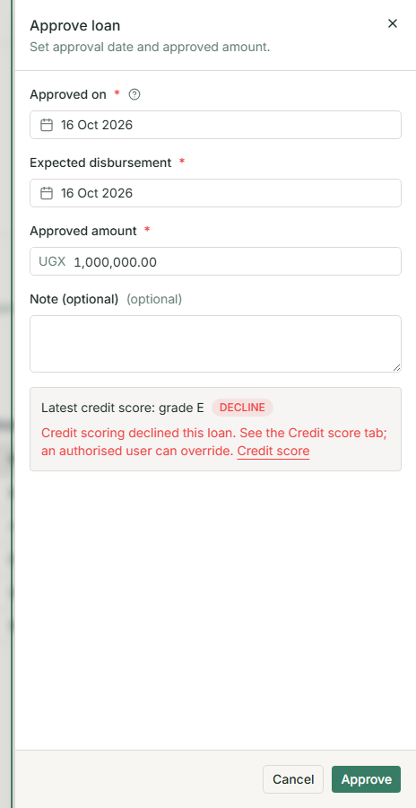

The sheet says credit scoring declined this loan, and that an authorised user can override it from the Credit score tab. The blocked approval is recorded as its own decision with trigger APPROVE, which is why the credit score later shows APPROVE even though the loan was not approved.

### Override the decision

An authorised officer can replace the outcome when the branch has checked the case.

Close the approve sheet. On **Credit score**, click **Override**. Set **New outcome** to Refer, **Reason** to Float verified at branch, and **Comment** to Agent recruited via branch, float verified. Click **Save override**.

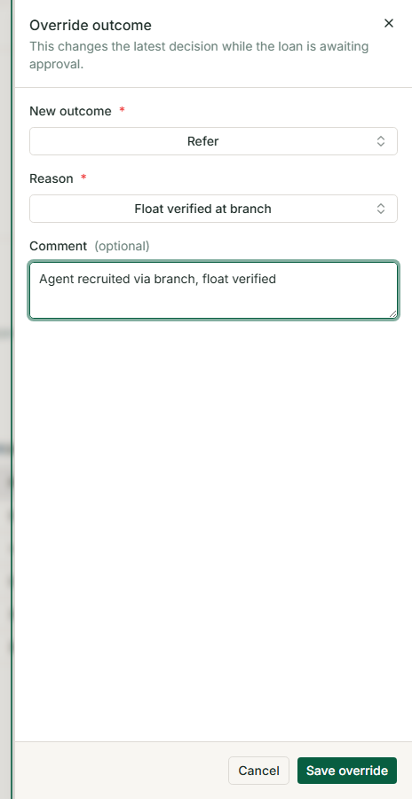

The comment is what the next approver will read. A checker may have to approve the override before it takes effect.

### Overridden decision

The override changes the outcome the rest of the loan uses. It does not change the points.

Open **Credit score** again after the override is approved.

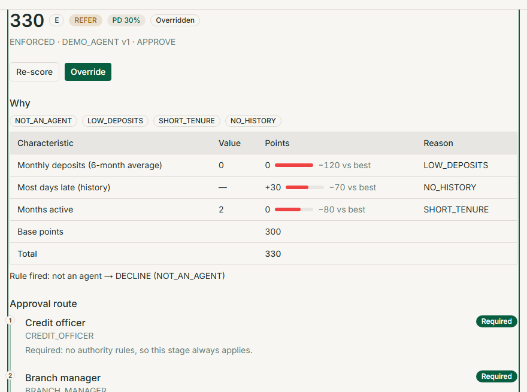

The score is still 330 and the grade is still E. The outcome shown is REFER, with an Overridden badge.

### Brian’s route

A referral and an override pull in the later stages you configured.

Read **Approval route** on the same tab.

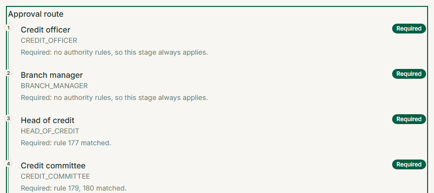

Head of credit is Required because the outcome is REFER. Credit committee is Required because the decision was overridden.

### Brian approved

Once the outcome is Refer rather than Decline, enforced mode allows the approval to go through.

Click **Approve** and let the checker complete it.

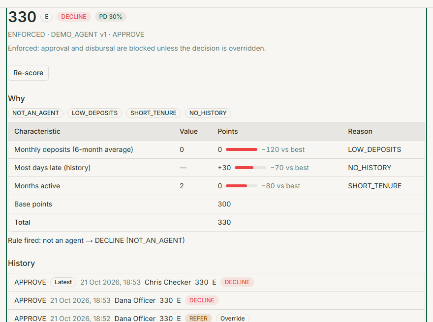

The loan status is Approved. The credit score still shows the override.

### Override lapsed

A re-score throws away the override, because the facts may have changed.

On Brian’s loan, click **Re-score** and confirm **Re-score**. Open the newest decision under **History**.

> **Important:** Do not re-score a loan if you still need the override. Re-scoring always drops it. On an approved loan in Enforced mode, the disbursal is then blocked. Undo the approval, override again, and re-approve.

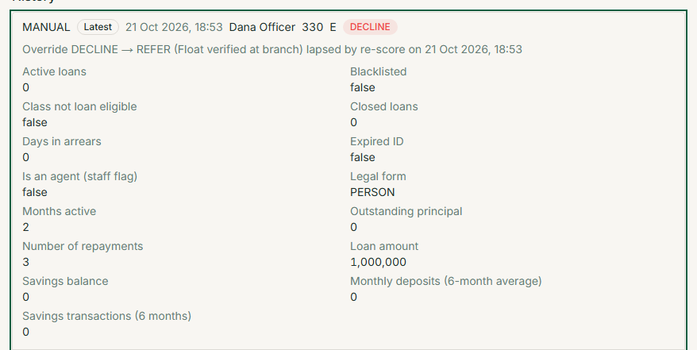

The newest decision is MANUAL and DECLINE. The override shows as lapsed.

Under the hood

The override is stored on the decision. Re-score runs the loan score command again and marks the previous override as lapsed.

## Part 7 — Pre-approved limits for agents

By the end of this part, Amina has a 4,330,000 UGX limit, a 5,000,000 UGX loan is blocked, and a 4,000,000 UGX loan is disbursed with 330,000 UGX left.

### Behavioural scorecard

Pre-approved limits use a behavioural card, scored overnight, not the application card.

Create **DEMO_AGENT_BEHAVIOUR**, name Agent behaviour, type Behavioural, base points 300. Deposits from 2,000,000 score 200, from 500,000 score 100, and from 0 score 0. Months from 24 score 100, and under 24 score 0. Bands: A 560 to 1,000, PD 1%, Approve; B 480 to 559, PD 3%, Approve; C 0 to 479, PD 10%, Refer. Save, activate, and let the checker approve.

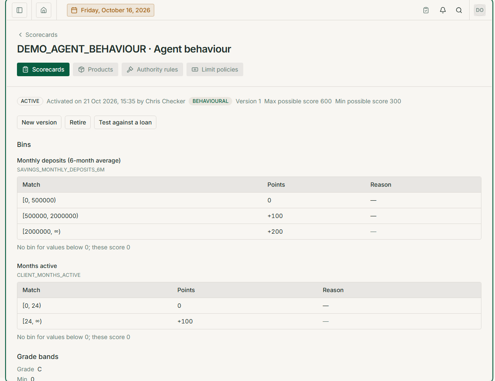

Status is ACTIVE and the type is BEHAVIOURAL. Amina’s facts score 600, which is grade A.

### Limit policy

The policy turns a behavioural grade into a UGX limit.

Open **Limit policies** and click **New policy**. Code DEMO_AGENT_FLOAT, name Agent float limit, scorecard DEMO_AGENT_BEHAVIOUR, product Agent float loan, mode Enforced. On the next step turn on **Staff only**, set **Valid days** to 35, **Base characteristic** to monthly deposits, and **Rounding unit** to 10000. Grade A uses multiplier 2 and max 5,000,000. Grade B uses multiplier 1 and max 2,000,000. Click **Save**.

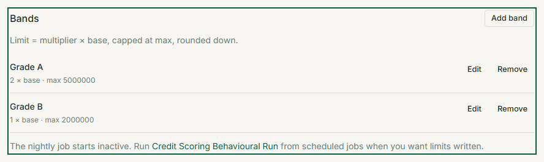

The policy is enforced and staff only. A limit lasts 35 days. Amounts are rounded down to the nearest 10,000 UGX.

### Behavioural job

Limits are written when this job runs, not when you save the policy.

Open **System**, then **Manage jobs**. If the job is inactive, turn it on. Filter for Credit Scoring Behavioural Run, select it, click **Run selected jobs**, then **Run jobs**.

> **Tip:** The nightly job is created inactive. Turn it on, or run it yourself, before you expect limits on customer pages.

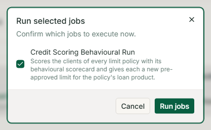

The job finishes without an error. Amina receives a limit. Brian does not, because he is not staff.

### Amina’s limit

The officer sees the limit on the customer, before starting a loan.

Open Amina Nakato’s customer page.

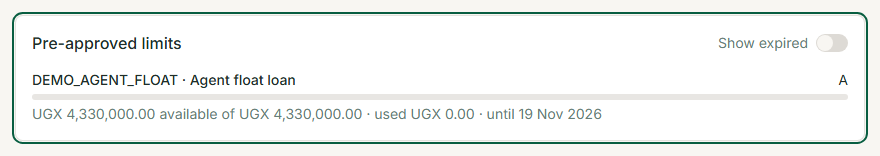

Pre-approved limits shows DEMO_AGENT_FLOAT on Agent float loan, grade A, UGX 4,330,000.00 available, and valid until 19 Nov 2026.

### No limit

A staff-only policy does not write a limit for a customer who is not an agent.

Open Brian Okello’s customer page.

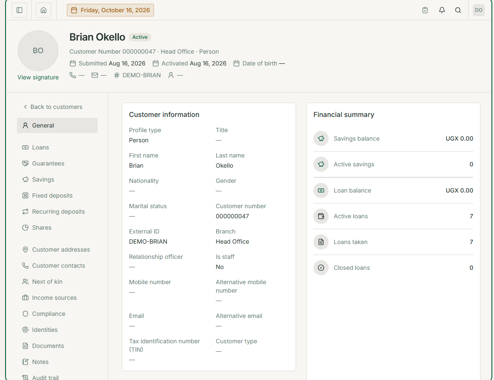

There is no Pre-approved limits card.

### Above the limit

Enforced limits stop an amount the customer does not have room for.

Start an Agent float loan for Amina for 5,000,000 UGX and try to approve it.

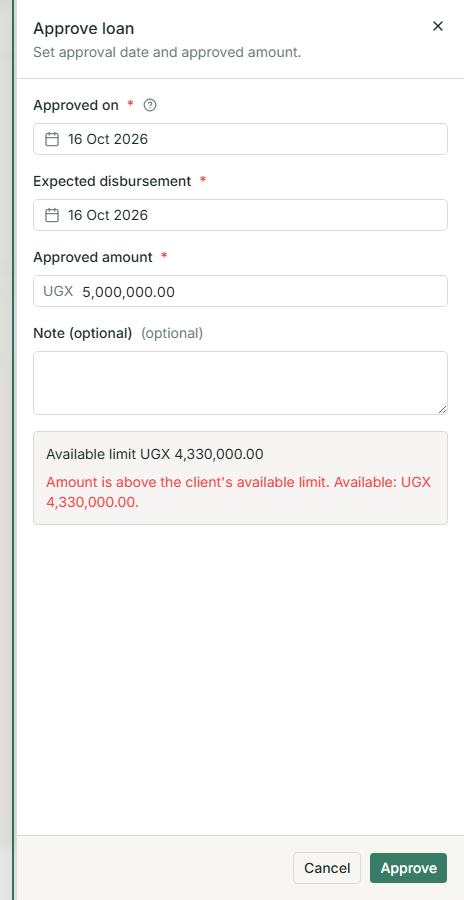

The sheet says the amount is above the client’s available limit and shows the available UGX 4,330,000.00. The loan is not approved.

### Within the limit

An amount inside the limit can be approved and disbursed.

Submit an Agent float loan for 4,000,000 UGX. Approve it, let the checker finish, then click **Disburse** and confirm.

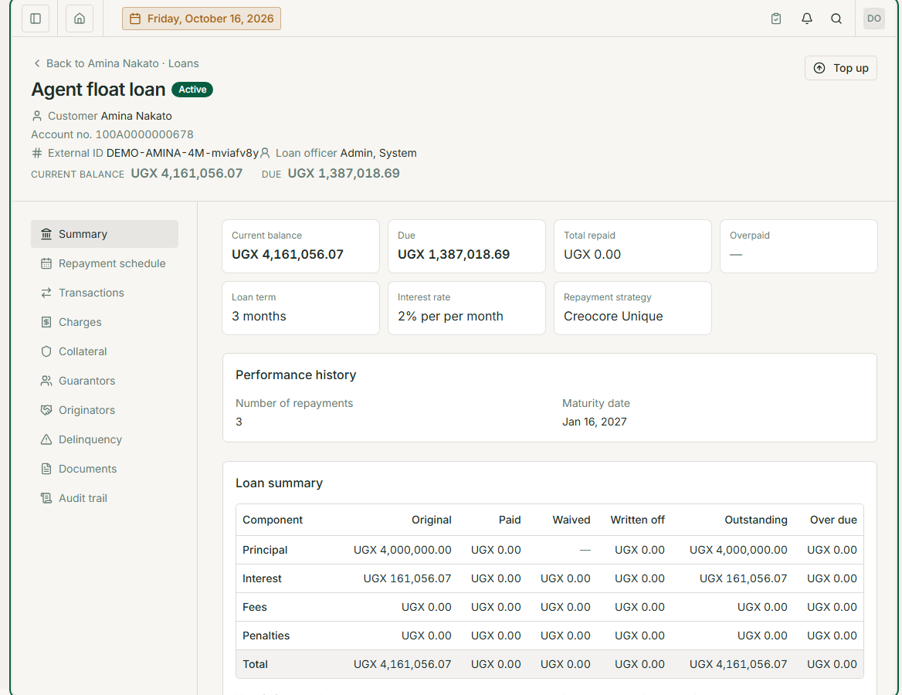

The loan is active and the disbursed amount is UGX 4,000,000.00.

### Limit used

Disbursement uses up the limit, so the next loan sees what is left.

Open Amina Nakato’s customer page again.

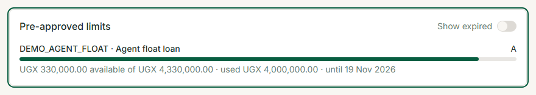

Used is UGX 4,000,000.00. Available is UGX 330,000.00 of the original UGX 4,330,000.00.

Under the hood

The limit policy is a scoring endpoint. Credit Scoring Behavioural Run is a scheduled job. The customer page reads the client limits. Approve and disburse still use the loan commands, and the limit check runs inside them.

## How the score is calculated

These cut-offs belong to the example. Replace them with your own.

Amina’s application score:

| Piece | Points |
| --- | --- |
| Base | 300 |
| Deposits (about 2,166,667 a month, the top bin) | 120 |
| Tenure (30 months, the top bin) | 80 |
| History (missing, so not the best bin) | 30 |
| Total | 530 |

530 is grade B. Grade B is Approve. No decline rule fires, because she is an agent and she is not in arrears. The only reason you see is NO_HISTORY. Deposits and tenure are already the best bins, so those reasons are never shown. History is 70 points below its best bin of 100, which is the “−70 vs best” on the breakdown. PD for grade B is 3%.

Brian’s application score:

| Piece | Points |
| --- | --- |
| Base | 300 |
| Deposits (none) | 0 |
| Tenure (about 2 months) | 0 |
| History (missing) | 30 |
| Total | 330 |

330 is grade E, and grade E is already Decline. The NOT_AN_AGENT rule also declines him, because he is not staff. The reasons, in order, are NOT_AN_AGENT, LOW_DEPOSITS, SHORT_TENURE, and NO_HISTORY. The badge says DECLINE. It does not add “by rule”, because the grade band reached the same outcome as the rule.

Amina’s limit uses the behavioural card, not DEMO_AGENT. Base 300, plus 200 for deposits, plus 100 for tenure, is 600. That is grade A. Her average monthly deposits are 2,166,666.67. The policy multiplies that by 2, which is 4,333,333.34, then rounds down to the nearest 10,000. The limit is 4,330,000, under the 5,000,000 maximum on grade A. Valid days include the business date, so 35 days from 16 Oct 2026 ends on 19 Nov 2026. After a 4,000,000 disbursement, used is 4,000,000 and available is 330,000.

## Reference

### Modes

| Mode | What the officer sees | What it blocks |
| --- | --- | --- |
| Off | No score | Nothing |
| Advisory | The score is stored and shown | Nothing. A decline is only advice. |
| Enforced | The score is stored and shown | A decline stops approval and disbursal until someone overrides it. A limit policy in this mode also stops an amount above the available limit. |

### Outcomes

| Outcome | At approval | At disbursal |
| --- | --- | --- |
| Approve | Allowed, subject to the approval route and any limit | Allowed, subject to any limit |
| Refer | Allowed, and the referral rule can add a later stage | Allowed, subject to any limit |
| Decline | Blocked when the product is Enforced | Blocked when the product is Enforced |

In Advisory mode a decline is recorded and does not block either step.

### Reason codes in this example

| Code | Meaning | What the officer can do |
| --- | --- | --- |
| NO_HISTORY | There is no stored late-payment history | Read it. It still adds the missing-history points. |
| LOW_DEPOSITS | Monthly deposits are under 500,000 | Ask for a stronger float, or use a product that does not require it |
| MODERATE_DEPOSITS | Monthly deposits are from 500,000 and under 2,000,000 | Nothing required. The top bin was not reached. |
| SHORT_TENURE | The customer has been active for under 6 months | Wait, or refer if your policy allows a new customer |
| MEDIUM_TENURE | Active from 6 months and under 24 months | Nothing required. The top bin was not reached. |
| PAST_LATE_PAYMENT | A past payment was late, but not in the worst bin | Read the arrears before you approve |
| SERIOUS_PAST_ARREARS | Past lateness is in the worst bin | Expect a lower score. A rule may also decline current arrears. |
| NOT_AN_AGENT | The customer is not marked as staff | This product is for agents. Decline stands unless you override it. |
| IN_ARREARS | Current days in arrears are over 30 | The rule declines the loan |
| ID_EXPIRED | The identity document is expired | Renew the document and score again |
| BLACKLISTED | The customer is blacklisted | Do not continue |
| CLASS_NOT_ELIGIBLE | The customer class cannot take this loan | Choose another product or change the class if that is allowed |

### Permissions

| Permission | Who needs it |
| --- | --- |
| Create, update, and activate scorecards | Credit manager |
| Update product scoring | Credit manager |
| Read a credit decision | Loan officer and approver |
| Override a decision | The officer allowed to override |
| Score a loan again | Loan officer or credit manager |
| Create authority rules | Credit manager |
| Create limit policies and read limits | Credit manager, and the officer who must see the limit |
| Create, approve, and disburse a loan | Loan officer and approver |
| Checker inbox | Approver |

## Troubleshooting

**Credit scoring declined this loan. See the Credit score tab; an authorised user can override.**

The product is Enforced and the outcome is Decline. Open **Credit score**. If the case should continue, an authorised user clicks **Override**. In Advisory mode this message does not appear.

**Amount is above the client's available limit.**

The Agent float loan is larger than the available pre-approved limit. Lower the amount, or wait for a new limit after the next behavioural run. The message includes the available amount.

**The client has no current pre-approved limit for this product.**

There is no current limit for this customer and product. Check that the customer is an agent when the policy is staff only, that the policy is not Off, and that **Credit Scoring Behavioural Run** has completed since the policy was saved.

**Only a draft scorecard can be edited.**

The card is active. Click **New version**, change the draft, and activate it when you are ready. Activating retires the previous live version.
